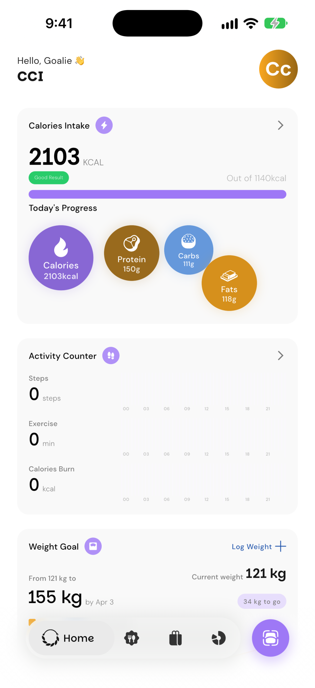
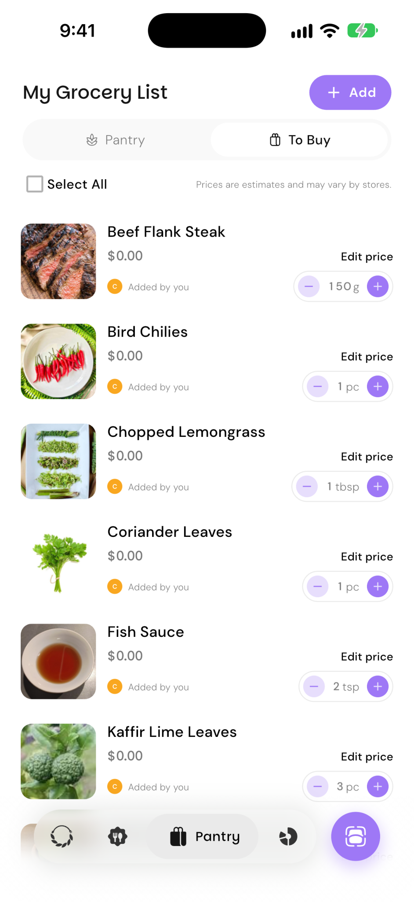
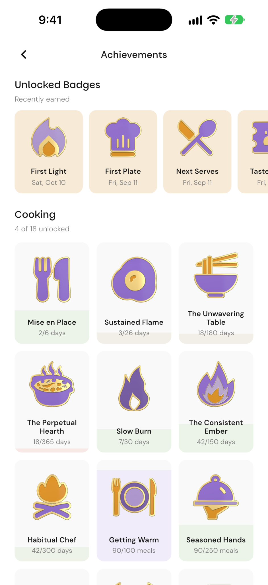
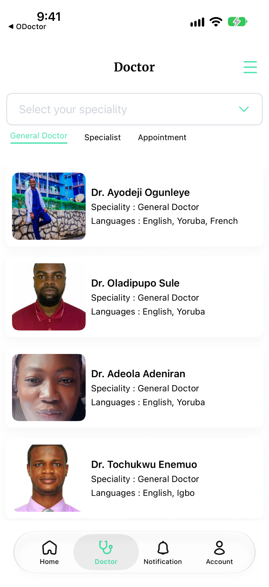
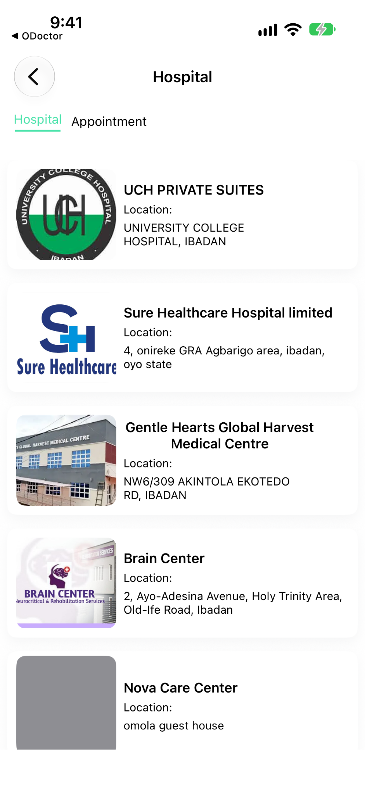

# David Olatokunbo

**Mobile Engineer · Flutter & iOS**  
Lagos, Nigeria

<a href="https://www.linkedin.com/in/olatokunbodavid"><picture><source media="(prefers-color-scheme: dark)" srcset="assets/contact-linkedin-dark.svg"></picture></a> <a href="mailto:davidolatokunbo7@gmail.com"><picture><source media="(prefers-color-scheme: dark)" srcset="assets/contact-email-dark.svg"></picture></a>

I’m David. I develop mobile apps and pay close attention to the way people interact with them: the touch feedback, transitions and small decisions that make a screen easier to use.

## Selected work

### PlannedRations · Flutter

[Try on TestFlight](https://testflight.apple.com/join/kd2ptwHy) · [Try on Android](https://appdistribution.firebase.dev/i/9fad2e4f8e30e920)

I delivered the first Flutter app, connecting personalized meal plans, food logging, pantry management and guided cooking. My work also covers health tracking, subscriptions and family access.

I created **41 interactive 3D enamel achievement badges**, with animated reveals and flip-and-spin interactions, and reduced their asset bundle from **39.7 MB to 14.8 MB**.

   &nbsp;
   &nbsp;
   &nbsp;
  

Home &nbsp;·&nbsp; Meal planning &nbsp;·&nbsp; Grocery lists &nbsp;·&nbsp; Collectible achievements

### Ohealth · iOS

[Ohealth on the App Store](https://apps.apple.com/ng/app/ohealth-app/id6479705696) · [ODoctor on the App Store](https://apps.apple.com/ng/app/odoctor/id6501959008)

I developed iOS workflows across **Ohealth, ODoctor and Onotify**, connecting patients and doctors through video consultations and chat. I also connected patient accounts to hospital records and implemented laboratory, pharmacy and staff workflows.

   &nbsp;
  

Find a doctor &nbsp;·&nbsp; Connect with a hospital

### Leads Profile / Enstead · Backend

I implemented customer ordering, pricing and payment review, with lead allocation and scheduled delivery in Node.js and Express.

## Stack

### Mobile

<picture><source media="(prefers-color-scheme: dark)" srcset="assets/stack-flutter-dark.svg"></picture>
<picture><source media="(prefers-color-scheme: dark)" srcset="assets/stack-dart-dark.svg"></picture>
<picture><source media="(prefers-color-scheme: dark)" srcset="assets/stack-swift-dark.svg"></picture>
<picture><source media="(prefers-color-scheme: dark)" srcset="assets/stack-riverpod-dark.svg"></picture>
<picture><source media="(prefers-color-scheme: dark)" srcset="assets/stack-isar-dark.svg"></picture>

### Integrations

<picture><source media="(prefers-color-scheme: dark)" srcset="assets/stack-healthkit-dark.svg"></picture>
<picture><source media="(prefers-color-scheme: dark)" srcset="assets/stack-healthconnect-dark.svg"></picture>
<picture><source media="(prefers-color-scheme: dark)" srcset="assets/stack-revenuecat-dark.svg"></picture>
<picture><source media="(prefers-color-scheme: dark)" srcset="assets/stack-rest-dark.svg"></picture>
<picture><source media="(prefers-color-scheme: dark)" srcset="assets/stack-socketio-dark.svg"></picture>

### Backend

<picture><source media="(prefers-color-scheme: dark)" srcset="assets/stack-nodejs-dark.svg"></picture>
<picture><source media="(prefers-color-scheme: dark)" srcset="assets/stack-javascript-dark.svg"></picture>
<picture><source media="(prefers-color-scheme: dark)" srcset="assets/stack-typescript-dark.svg"></picture>
<picture><source media="(prefers-color-scheme: dark)" srcset="assets/stack-express-dark.svg"></picture>
<picture><source media="(prefers-color-scheme: dark)" srcset="assets/stack-mongodb-dark.svg"></picture>

### Tools

<picture><source media="(prefers-color-scheme: dark)" srcset="assets/stack-git-dark.svg"></picture>
<picture><source media="(prefers-color-scheme: dark)" srcset="assets/stack-githubactions-dark.svg"></picture>
<picture><source media="(prefers-color-scheme: dark)" srcset="assets/stack-claude-dark.svg"></picture>
<picture><source media="(prefers-color-scheme: dark)" srcset="assets/stack-codex-dark.svg"></picture>

